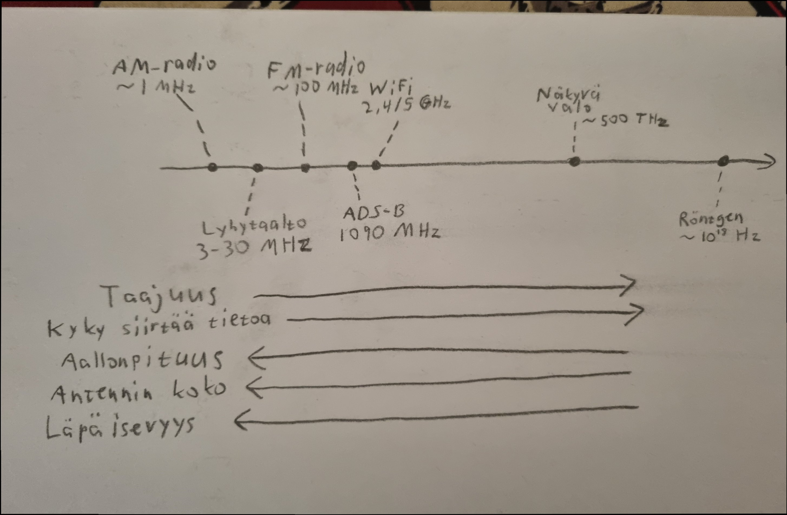
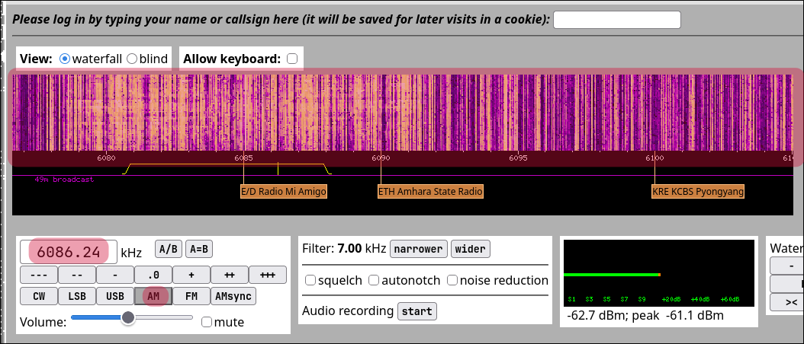
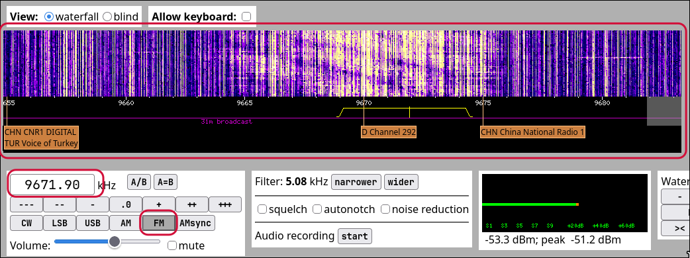
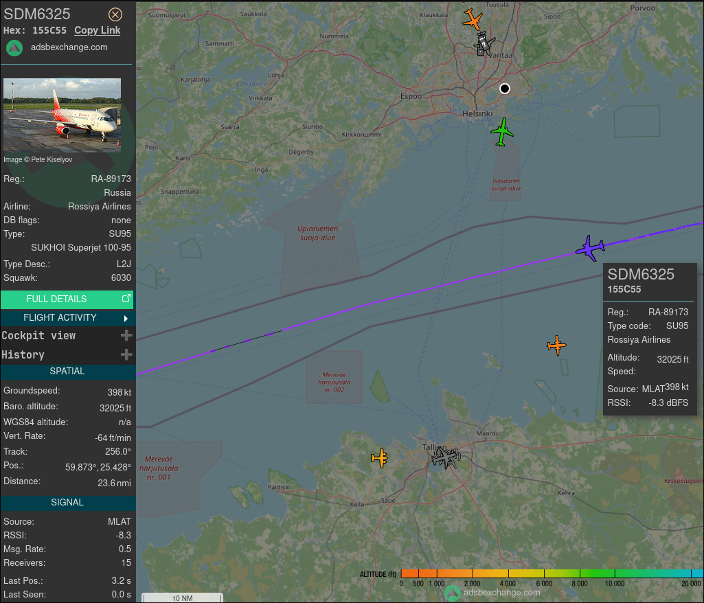

# h1 Korva netissä

## x) Skeptrini

---

## a) WebSDR

Menin [WebSDR](http://websdr.org/) sivustolle ja menin katsomaan listaa vastaanottimista maailmalla

Testasin ensimmäistä listattua vastaanotinta, joka sijaitsee Twenten yliopistossa, Enschedessä Hollannissa.

[Twenten vastaanotin](http://websdr.ewi.utwente.nl:8901/)

---

Löysin 6085 kHz taajuudelta kanavan "E/D Radio Mi Amigo", jolla soi sillä hetkellä John Waiten kappale "Missing You".

Taajuus 6085 kHz osuu 49 metrin yleisradiokaistalle. Aallonpituus on:

λ = c / f = 3 × 10⁸ m/s / 6 085 000 Hz ≈ 49,3 m

Modulaatio on AM.

Asemalta kuului musiikkia ja perus musiikki radiokanavan välipuheita.

---

## b) Moduwhat?

Löysin FM-modulaatiolla kanavan "D Channel 292", josta kuului musiikkia, mutta kappaletta oli vaikeampi saada selville huonon laadun takia.

Kanava oli 9670 kHz:n paikkeilla.

9670 kHz on 31 metrin yleisradiokaistalla. Aallonpituus on:

λ = 3 × 10⁸ m/s / 9 670 000 Hz ≈ 31,0 m

---

## c) ADS-B

Menin sivustolle [ADS-B Exchange](https://globe.adsbexchange.com/) ja etsin jonkin koneen sieltä.

Valitsin SDM6325 koneen, joka on Venäläinen matkustajakone.

Lennon tunnus on SDM6325. SDM on Rossiya Airlinesin ICAO-yhtiötunnus. Kone on Sukhoi Superjet 100-95 (tyyppikoodi SU95), venäläinen kapearunkoinen alueliikennekone. Tyyppikuvaus L2J tarkoittaa maakonetta (Land), jossa on kaksi (2) suihkumoottoria (Jet). Rekisteritunnus on RA-89173 (RA- on Venäjän kansallisuustunnus), ja ICAO-osoite on 155C55. Se on transponderiin ohjelmoitu 24-bittinen yksilöllinen tunniste, joka kuuluu Venäjälle varattuun osoitelohkoon.

Ruutukaappauksen hetkellä kone oli:

- Korkeudella 32 025 ft (≈ 9,8 km), barometrinen korkeus
- Nopeudella 398 solmua maanopeutta (≈ 737 km/h)
- Suunnassa 256°, eli länsilounaaseen
- Pystynopeudella −64 ft/min, eli käytännössä vaakalennossa matkakorkeudella
- Sijainnissa 59,873° N, 25,428° E, Suomenlahden keskellä Helsingin ja Tallinnan välissä
- Squawk-koodilla 6030, jonka lennonjohto antaa

Koneen sijainti on laskettu multilateraatiolla:

1. Koneen Mode S -transponderi lähettää taajuudella 1090 MHz (λ ≈ 27,5 cm) viestejä, joissa ovat ICAO-osoite ja barometrinen korkeus.

2. Viestin kuuli 15 vastaanotinta (Receivers: 15). Ne ovat vapaaehtoisten maa-asemia, joissa on usein RTL-SDR-tikku ja pieni antenni.

3. Jokainen vastaanotin leimaa viestin saapumisajan tarkalla, GPS:llä synkronoidulla kellolla.

4. Palvelin laskee koneen sijainnin siitä, kuinka paljon myöhemmin sama viesti saapui eri vastaanottimiin (TDOA, time difference of arrival). Signaali kulkee valon nopeudella, joten aikaero kertoo etäisyyseron.

---

## Lähteet

[Tehtävänanto](https://terokarvinen.com/verkkoon-tunkeutuminen-ja-tiedustelu/#laksyt)

[WebSDR](http://websdr.org/)

[ADS-B Exchange](https://globe.adsbexchange.com/)
