# h2 Nuuh

---

## x) Lue ja tiivistä

### **Wireshark - Getting Started:**

Tässä Teron artikkelissa kerrotaan, kuinka Wireshark ladataan ja mitä sillä voi tehdä.

- Käyttäjä pitää lisätä 'wireshark' -ryhmään, jotta sitä voi käyttää non-root käyttäjänä.
- Päänäkymässä on lista paketteja, jota käyttöliittymä on vastaanottanut ja/tai lähettänyt.
- Paketti yhteenvetoja voi tallentaa ja katsella myöhemmin.

---

### **Network Interface Names on Linux:**

Tässä Teron artikkelissa verkkoliitäntöjen nimistä Linuxissa.

- Verkkoliitäntä ei ole sama kuin fyysinen verkkokortti.
- Nimen alkuosa kertoo liitännän tyypin. (en tarkoittaa langallista Ethernettiä, wl langatonta WLAN-/WIFI-yhteyttä)
- Loopback on vain koneen sisäiseen liikenteeseen.

---

## a) Linux

Latasin Kali Linux .vbox tiedoston heidän nettisivuilta ja lisäsin sen VirtualBoxiin.

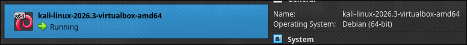

---

## b) Ei voi kalastaa

Kalissa oikeasta yläkulmasta painoin Ethernet portilta näyttävästä kuvakkeesta
ja 'Disconnect' -napista sain netin katkaistua.

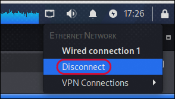

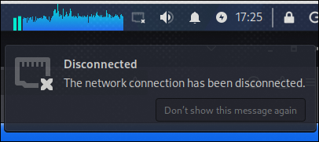

Netin saa takaisin painamalla 'Wired connection 1' samasta valikosta.

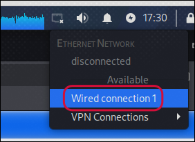

---

## c) Wireshark

Kali Linuxissa Wireshark on asennettu ja konfiguroitu suoraan laatikosta, joten avasin sen ja valitsin 'eth0' verkkoliitännän.

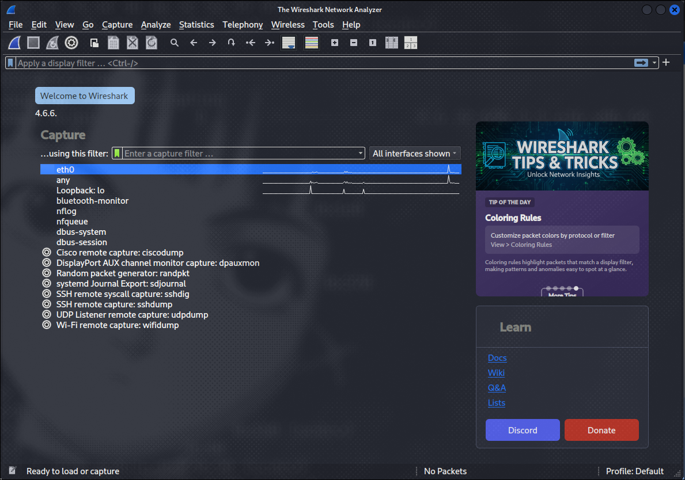

---

Heti kun klikkasin liitännästä Wireshark aloitti pakettien sieppaamisen. Kävin selaimessa YouTubessa ja hain 'cat video',
odotin että video alkaa soimaan ja lopetin sieppauksen.

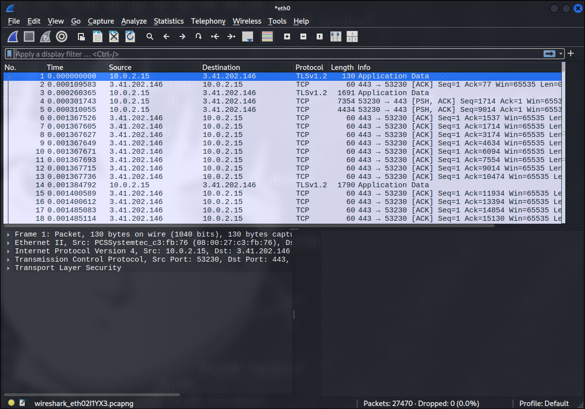

Virtuaalikone jostain syystä jäätyi tämän jälkeen, joten tein samat askeleet uudestaan ennen d) tehtävän aloitusta.

---

## d) Oikeesti TCP/IP

---

### Ongelmia

VM kaatui aina kun lopetin sieppaamisen Wiresharkissa, joten googlasin mikä mahtaisi olla vikana.

Yksi ratkaisu oli 'Promiscuous Mode':n pois päältä laittamisen.

Tämä ei auttanut minua, joten kokeilin seuraavaa ratkaisua.

'Isolate via dumpcap (Bypass the Wireshark GUI)'.

Komento, jota kokeilin oli `dumpcap -i 1 -w capture_output.pcapng`, jossa 1 on verkkoliitännän nimi.

VM vieläkin kaatui, joten kysyin Googlen AI:lta (Gemini) mikä mahtaa olla vikana, ja se sanoi,
että 'Adapter Type' vaihtaminen 'Paravirtualized Network' voisi auttaa.

---

### Paketin kerrokset

Adapteri tyypin vaihtaminen onnistui korjaamaan jäätymisen.

Sieppasin paketteja ja lyhyessä ajassa (~50 sekuntia), sain siepattua yli 35 tuhatta pakettia.

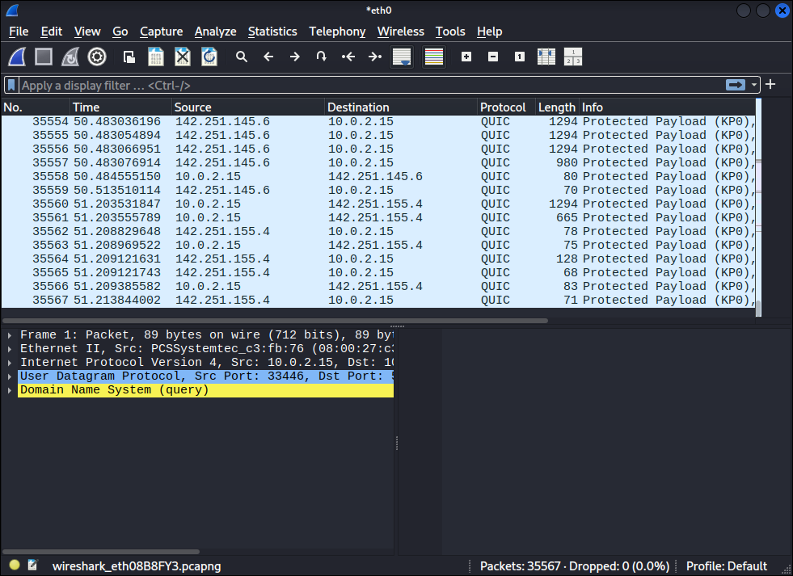

Paketeista voimme katsoa sen eri kerroksia 'Packet Details' -näkymässä.

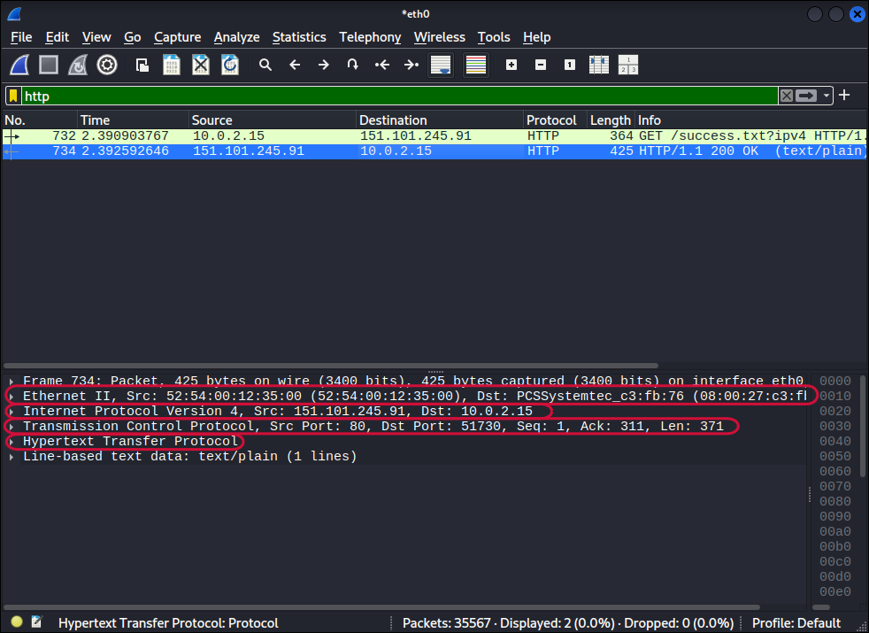

Kuvassa näkyy paketin eri kerrokset laatikoittain.

- **Linkkikerros**: Ethernet II
- **Internet-kerros**: Internet Protocol Version 4
- **Kuljetuskerros**: Transmission Control Protocol
- **Sovelluskerros**: Hypertext Transfer Protocol

---

## e) Mitäs tuli surffattua?

.pcap tiedostossa, joka löytyy tehtävänannosta Teron sivuilla, näkyy kaappaus jota voi katsella Wiresharkilla.

### **Laitteet**

Kaappauksessa näkyy vain kaksi laitetta. Toinen on selaava kone `192.168.122.7`, joka on mukana lähes kaikissa paketeissa.

Toinen on `192.168.122.1`, joka toimii yhdyskäytävänä ja DNS-palvelimena.

---

### **Protokollat**

Näkyviin tulee kolme protokollaa:

- **HTTPS (TLS, TCP 443)**, noin 237 pakettia. Sisältö on salattua,
joten siitä ei näe, mitä sivuja ladattiin. TLS Client Hello -viesteissä
näkyy kuitenkin palvelimen nimi (SNI) selväkielisenä, ja siinä esiintyivät
terokarvinen.com sekä goatcounter-kävijälaskurin osoitteet.
- **DNS (UDP 53)**, 30 pakettia. Kyselyt menevät salaamattomina, ja niistä näkyvät
terokarvinen.com, commentero.terokarvinen.com, terokarvinen.goatcounter.com,
gc.zgo.at ja <www.google.com>.
- **QUIC (UDP 443)**, 14 pakettia Googlen palvelimelle.

Lisäksi kaappauksessa on pari ARP-pakettia.

Kaappauksesta saa siis selville, kenen palvelimia käyttäjä kävi katsomassa, vaikka HTTPS piilottaa itse sisällön.
DNS-kyselyt ja SNI paljastavat domainit, ja IP-osoitteista ja ajoituksista näkee liikenteen määrän ja rytmin.
Myös analytiikkapalvelun (GoatCounter) käyttö näkyy liikenteestä.

---

## f) Mitä selainta käyttäjä käyttää

Kysyin Claude Opus 5.5 -tekoälymallilta miten tämän saisi selville, ja se vastasi, että käyttäjä on käyttänyt Firefox -selainta.

Sen näkee Client Hello -viesteissä olevista laajennuksista `delegated_credentials` ja `record_size_limit`, jotka ovat tyypillisiä Firefoxille.

GREASE-arvoja ei myöskään ole, joita Chrome ja muut Chromium -pohjaiset selaimet lisäävät viestiin tahallaan.

Laajennusten järjestys pysyy myös samana kaikissa yhteyksissä, jonka Chrome sekoittaa jokaisessa yhteydessä versiosta 110 lähtien.

---

## g) Minkä merkkinen verkkokortti käyttäjällä on?

Selaavan koneen (192.168.122.7) MAC-osoite on `52:54:00:2f:e1:e5`. Valmistajan tunnistaa yleensä MAC-osoitteen kolmesta
ensimmäisestä tavusta (OUI), ja etuliite `52:54:00` on QEMU/KVM:n virtuaalisille verkkokorteille
käyttämä oletusetuliite. Libvirt antaa virtuaalikoneille juuri tällaisia osoitteita.

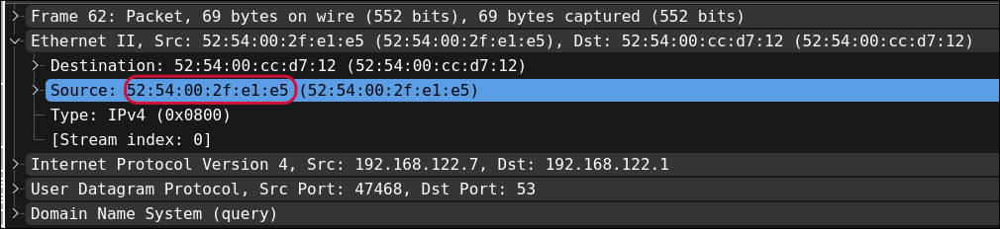

---

## h) Millä webbipalvelimella käyttäjä on surffaillut?

DNS-kyselyissä näkyy, että palvelin terokarvinen.com ja commentero.terokarvinen.com ovat molemmat
samalla palvelimella, joka on osoitteessa `139.162.131.217`.

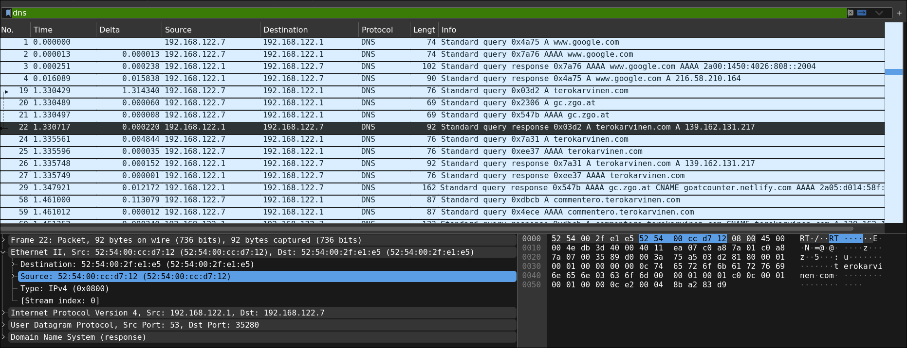

---

Server Name näkyy myös TLS Client Hello -viestin SNI-kentästä.

Suodattimella `tls.handshake.extensions_server_name` näkyy kenttä Server Name: terokarvinen.com.

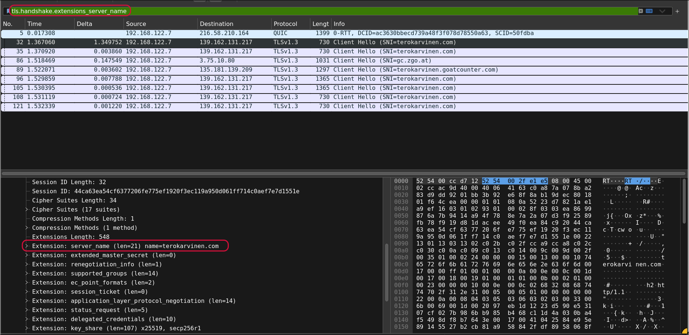

---

`whois 139.162.131.217` komennolla voi selvittää palvelimen omistajan.

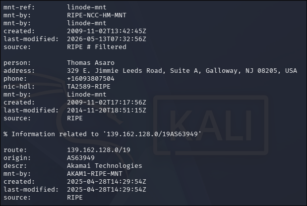

Omistaja on Linode (nykyään Akamai) eli sivusto on vuokrapalvelimella.

---

## i) Analyysi

Tein tämän analyysin omalla koneellani suoraan, koska virtuaalikone ei halunnut oikein toimia.

Kaappausympäristön käyttöjärjestelmä: Linux 7.3.1-1-cachyos

Verkkoliitäntä: enp5s0, joka on langallinen Ethernet.

Tein kaappausta Wiresharkilla noin 3,5 sekuntia ja kaappauksessa on 19 pakettia.

Verkossa näkyvät seuraavat osapuolet:

| **Laite** | **MAC** | **IP** |
| --------------- | --------------- | --------------- |
| Oma kone | 58:11:22:45:14:13 | 192.168.100.24, IPv6 fe80::fb56:3db2:3d5c:77e1 |
| Reititin | b4:a8:98:01:b3:1b | (yhdyskäytävä) |
| PlayStation 5 | 28:40:dd:74:ea:3a | 192.168.100.20 |
| Spotifyn palvelimet (Google Cloud) | - | 35.186.224.24 ja 35.186.224.34 |
| Google | - | 142.251.153.119 |

Valitsin analyysin kohteeksi paketit 6, 7 ja 8.

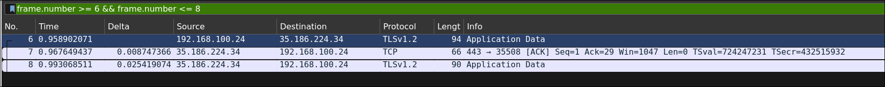

### **Mitä tapahtuu**

Koneellani 192.168.100.24 on valmiiksi auki salattu HTTPS-yhteys palvelimelle 35.186.224.34. Osoite kuuluu Google Cloudiin, ja koska samassa kaappauksessa on muuta Spotify-liikennettä, kyseessä on todennäköisesti Spotifyn palvelin. Yhteyden avaus (TCP-kättely ja TLS-kättely) tapahtui ennen kaappausta, joten siitä näkyy vain jatko.

| **#** | **Aika (s)** | **Suunta** | **Liput** | **Data** |
| --------------- | --------------- | --------------- | --------------- | --------------- |
| 6 | 0,958902 | kone -> palvelin | PSH, ACK | 28 tavua TLS:ää |
| 7 | 0,967649 | palvelin -> kone | ACK | ei dataa |
| 8 | 0,993069 | palvelin -> kone | PSH, ACK | 24 tavua TLS:ää |

Kone lähettää pienen salatun viestin, palvelin ilmoittaa saaneensa sen
ja lähettää vähän myöhemmin oman pienen vastauksensa.
Sisältöä ei voi lukea, mutta pienet ja säännölliset viestit ovat tyypillisesti
sovelluksen keep alive -viestejä, joilla yhteys pidetään auki.

### **Paketti 6: kone lähettää dataa**

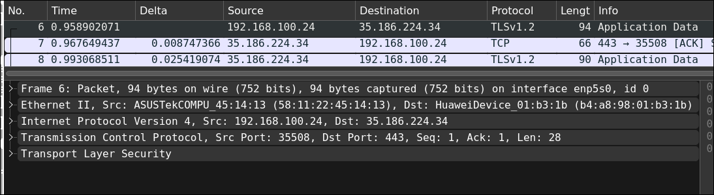

Paketti on 94 tavua, ja se koostuu sisäkkäisistä kerroksista: jokainen kerros lisää oman
otsakkeensa edellisen ympärille.

---

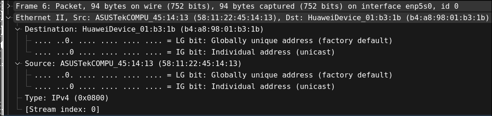

**Linkkikerros, Ethernet II (14 tavua).** Ethernet vastaa siitä, että kehys menee lähiverkossa
seuraavalle laitteelle.

- Kohde-MAC on `b4:a8:98:01:b3:1b`, joka on reitittimeni. Kehys ei mene suoraan
palvelimelle, koska Ethernet toimii vain lähiverkon sisällä. Kone tietää, että Internetiin
menevä liikenne kulkee reitittimen kautta, ja lähettää kehyksen sille.
- Lähde-MAC on `58:11:22:45:14:13`, eli oman koneeni verkkokortti
- Tyyppi `0x0800` kertoo vastaanottajalle, että kehyksen sisällä on IPv4-paketti.

---

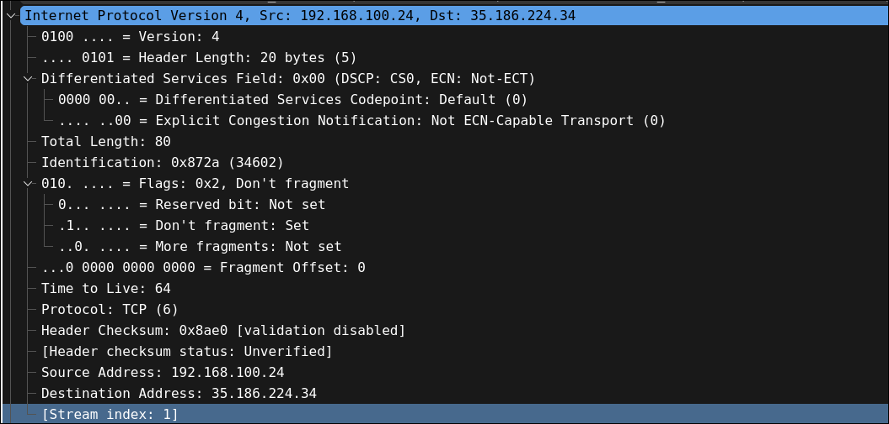

**Internet-kerros, IPv4 (20 tavua).** IP vastaa siitä, että paketti löytää perille koko internetin yli.

- `45` tarkoittaa IP-versiota 4 ja otsakkeen pituutta 5 x 4 = 20 tavua.
- Kokonaispituus on 80 tavua, eli IP-otsake, TCP-otsake ja data yhteensä ilman Ethernetiä.
- Tunniste `0x872a` on paketin juokseva numero. Seuraava kaappauksessa näkyvä oman
koneeni lähettämä paketti 9 saa numeron `0x872b`.
- Lippu Don’t Fragment (`0x4000`) kieltää pilkkomasta pakettia matkalla. Jos paketti olisi
jollekin reitin osuudelle liian suuri, se hylättäisiin ja lähettäjälle ilmoitettaisiin, jotta se voi
lähettää pienempiä paketteja.
- **TTL 64** (Time To Live). Jokainen reititin vähentää arvoa yhdellä, ja nollaan päätyvä paketti
hävitetään, jotta harhautunut paketti ei kierrä verkossa ikuisesti. 64 on Linuxin oletusarvo.
- Protokolla 6 kertoo, että sisällä on TCP.
- Lähdeosoite 192.168.100.24 on koneeni yksityinen osoite. Reititin vaihtaa sen omaan
julkiseen osoitteeseensa ennen kuin paketti lähtee internetiin (NAT). Kohdeosoite on
palvelin 35.186.224.34.

---

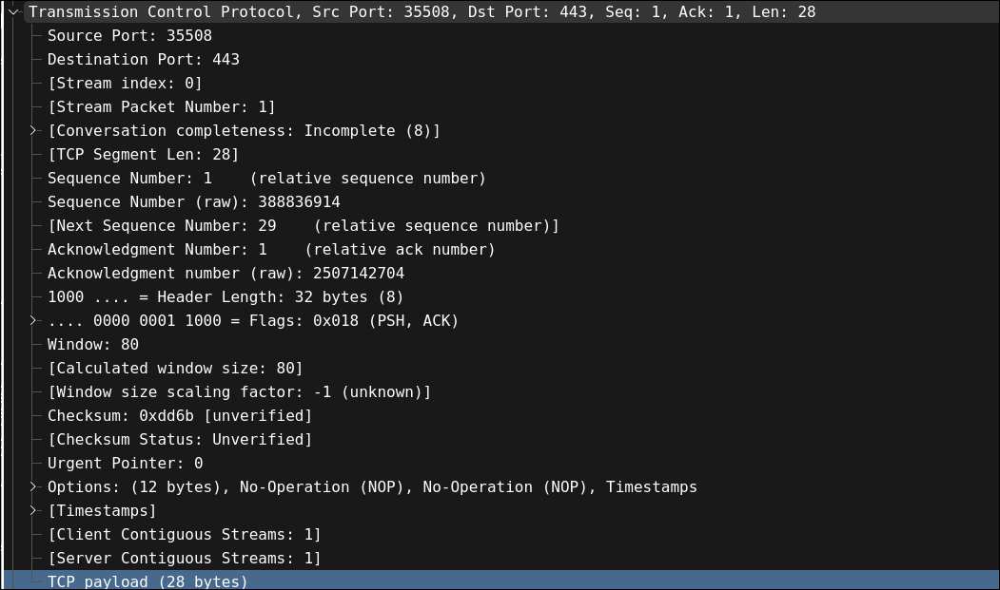

**Kuljetuskerros, TCP (32 tavua).** TCP huolehtii siitä, että data tulee perille kokonaisena ja oikeassa
järjestyksessä, ja että se päätyy oikealle ohjelmalle.

- Lähdeportti 35508 on käyttöjärjestelmän satunnaisesti valitsema asiakasportti. Kohdeportti
443 on HTTPS:n vakioportti. Osoitteet ja portit yhdessä yksilöivät yhteyden.
- **Järjestysnumero** (seq) `0x172d2e32` on tämän paketin ensimmäisen datatavun
järjestysnumero. TCP numeroi jokaisen lähetetyn tavun, jotta vastaanottaja voi järjestää ne ja
huomata puuttuvat.
- **Kuittausnumero** (ack) `0x956ff630` kertoo palvelimelle, että kaikki sitä edeltävät tavut on
vastaanotettu ja seuraavaksi odotetaan tavua tästä numerosta.
- Wireshark näyttää seq- ja ack-arvot oletuksena suhteellisina (alkaen nollasta tai ykkösestä),
jotta niitä on helpompi lukea. Raakanumerot näkyvät kentissä *Sequence Number (raw)*.
- **Liput PSH ja ACK.** ACK tarkoittaa, että kuittausnumero on voimassa, ja se on päällä
käytännössä kaikissa paketeissa kättelyn jälkeen. PSH pyytää vastaanottajana toimittamaan
datan sovellukselle heti eikä odottamaan lisää.
- Ikkuna 80 kertoo, kuinka paljon dataa kone voi vielä ottaa vastaan. Todellinen arvo on tämä
luku kerrottuna skaalauskertoimella, joka sovittiin yhteyden avauksessa. Koska avausta ei
ole kaappauksessa, Wireshark ilmoittaa kertoimen tuntemattomaksi.
- Optiot NOP, NOP ja Timestamps. NOPit ovat täytettä, jolla optiot tasataan neljän tavun
rajoille. Aikaleimoilla mitataan viivettä ja tunnistetaan vanhat, myöhässä tulevat paketit.

---

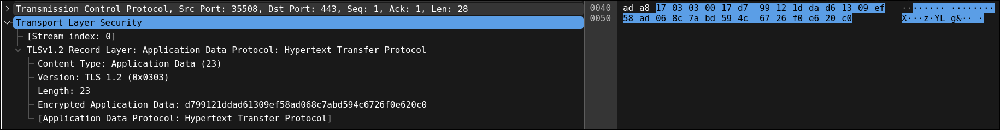

**Sovelluskerros, TLS (28 tavua).** TLS salaa sovelluksen datan.

- Tietueen tyyppi `0x17` on Application Data, eli salattua sovellusdataa.
- Versiokentässä on `03 03` eli TLS 1.2, vaikka uudet yhteydet ovat yleensä TLS 1.3:a. TLS 1.3
kirjoittaa tähän tarkoituksella 1.2:n, jotta vanhat palomuurit ja muut välilaitteet eivät hylkää
liikennettä. Oikean version näkisi vain kättelystä.
- Pituus on 23 tavua salattua dataa. Sen sisältöä ei näe, ja juuri siksi TLS on olemassa.

---

### **Paketti 7: palvelin kuittaa**

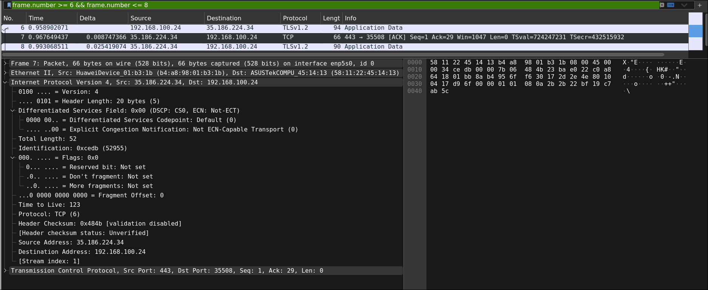

Paketti tulee 8,7 ms myöhemmin. Siinä ei ole lainkaan dataa, vain otsakkeet, ja ainoa lippu on
ACK.

- Ethernet-osoitteet ovat päinvastoin kuin paketissa 6: lähde on reititin ja kohde oma koneeni.
Palvelimen omaa MAC-osoitetta en näe koskaan, koska se ei ole lähiverkossani.
- IP-osoitteet ovat myös päinvastoin.
- **Kuittausnumero** on `0x172d2e4e`. Kun siitä vähentää paketin 6 järjestysnumeron
`0x172d2e32`, erotukseksi tulee 28, eli täsmälleen paketin 6 datamäärä. Palvelin ilmoittaa:
"sain 28 tavuasi, odotan seuraavaksi tavua numero 0x172d2e4e".
- Aikaero paketista 6 pakettiin 7 kertoo yhteyden edestakaisen viiveen (**RTT**): noin 8,7 ms.
Wireshark laskee tämän itse kenttään *[The RTT to ACK the segment was ...]*.
- **TTL on 123.** Lähettäjä on luultavasti aloittanut arvosta 128, joten reitillä oli noin viisi reititintä.
Tällä tavalla TTL:stä voi päätellä etäisyyden ja joskus käyttöjärjestelmänkin, mutta päätelmä
on epävarma, koska palvelimen edessä voi olla kuormantasaajia, jotka asettavat oman arvonsa.
- Palvelimen ikkuna on 1047 (taas kerrottuna tuntemattomalla kertoimella).

---

### **Paketti 8: palvelin vastaa**

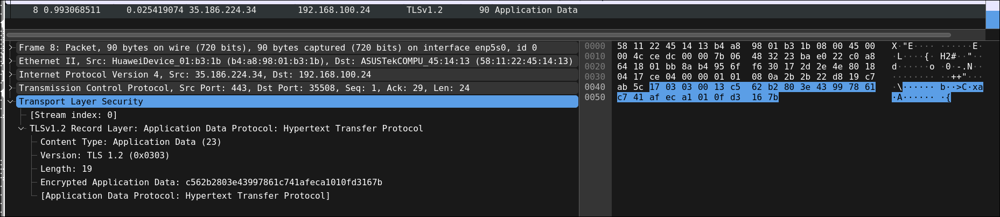

Paketti tulee noin 34 ms paketin 6 jälkeen.

- Liput ovat taas PSH ja ACK, eli mukana on dataa.
- Järjestysnumero on `0x956ff630`, eli täsmälleen se numero, jota koneeni kuittausnumero
paketissa 6 odotti. Data jatkuu siis aukottomasti.
- Kuittausnumero on sama kuin paketissa 7 (`0x172d2e4e`), koska koneeni ei ole lähettänyt
mitään uutta välissä.
- TLS-tietue on tyyppiä Application Data, ja siinä on 19 tavua salattua dataa, yhteensä 24 tavua
TLS-otsakkeen kanssa.

---

### **Mitä näistä kolmesta paketista voi päätellä**

- Koneeni ja palvelimen välillä on jo valmiiksi auki oleva, TLS:llä salattu yhteys.
- TCP:n järjestys- ja kuittausnumerot täsmäävät tavun tarkkuudella, joten mitään ei kadonnut
eikä tarvinnut lähettää uudelleen.
- Viive palvelimelle on noin 9 ms, ja palvelinsovellus vastaa noin 25 ms:ssa.
- Koneeni on todennäköisesti Linux (TTL 64), ja palvelin on noin viiden reitittimen päässä.
- Sisältöä ei voi lukea, mutta viestien pieni koko ja kaava viittaavat yhteyden ylläpitoon eikä
varsinaiseen tiedonsiirtoon.

---

## **Lähteet**

- [Tehtävänanto](https://terokarvinen.com/verkkoon-tunkeutuminen-ja-tiedustelu/#laksyt)
- [Wireshark - Getting Started](https://terokarvinen.com/wireshark-getting-started/)
- [Network Interface Names on Linux](https://terokarvinen.com/network-interface-linux/)
Claude Opus 5.5 Tekoälymalli
