# h3 Aaltoja harjaamassa

---

## x) Lue ja tiivistä

### Hubacek 2019 (3:19-7:40 ~4 min)

- Spectrum Analyzer optiolla voi tutkia laitteeseen yhdistettyjen vastaanottimien vastaanottamia taajuuksia
- Record Signal optiolla voi tallentaa vastaanotettuja signaaleja
- Demoduloinnilla voidaan erotella vastaanotettuja signaaleja taustamelusta.

### Cornelius 2022

- Kirjoittaja halusi selvittää aseman langattoman protokollan voidaakseen rakentaa oman, anturia jäljittelevän laitteen
- URH signaali paikannetaan spektrianalysaattorilla ja tallennetaan pienellä taajuussiirrolla.
- Modulaatiossa kyse on OOK:sta (ASK:n yksinkertaisin muoto) ja pulssivälimodulaatiosta: noin 500 µs kantaaaltopulssia sueraa 1 ms tauko (bitti 0) tai 2 ms tauko (bitti 1), ja pakettien välissä on 4 ms tauko.
- Melko samanlaisia URH -ohjelman käyttöön liittyviä ohjeita kuin ensimmäisellä videolla, mutta hieman yksityiskohtaisempia.

---

## b) rtl_433

Asennan `rtl_433` ohjelman `sudo pacman -S rtl_433` -komennolla, koska koneessani on Arch -perusteinen distro.

Seuraavassa ruudunkaappauksessa näkyy kun etsin onko pakettia olemassa repositoriossa

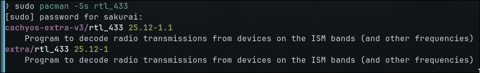

---

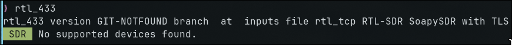

Vaikka versio näyttää hieman epämääräiseltä oletin, että ohjelma toimii ja siirryin seuraavaan vaiheeseen.

---

## c) Automaattinen analyysi

Latasin tehtävänannosta .cs8 tiedoston ja avasin sen `rtl_433` ohjelmassa analysoitavaksi komennolla `rtl_433 -r ~/Downloads/Converted_433.92M_2000k.cs8`.

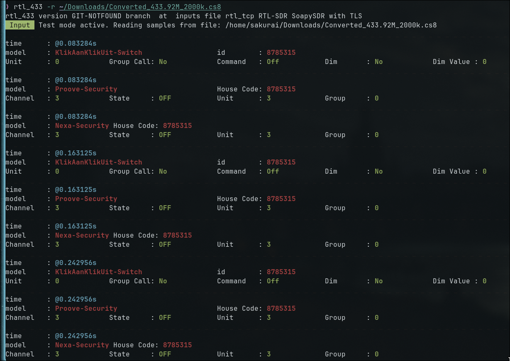

---

Analyysistä huomataan, että Nexa/KAKU-kaukosäädin (id: 8785315) lähettää OFF-komennon kanavaan 0, toistettuna viisi kertaa noin 80 ms välein.

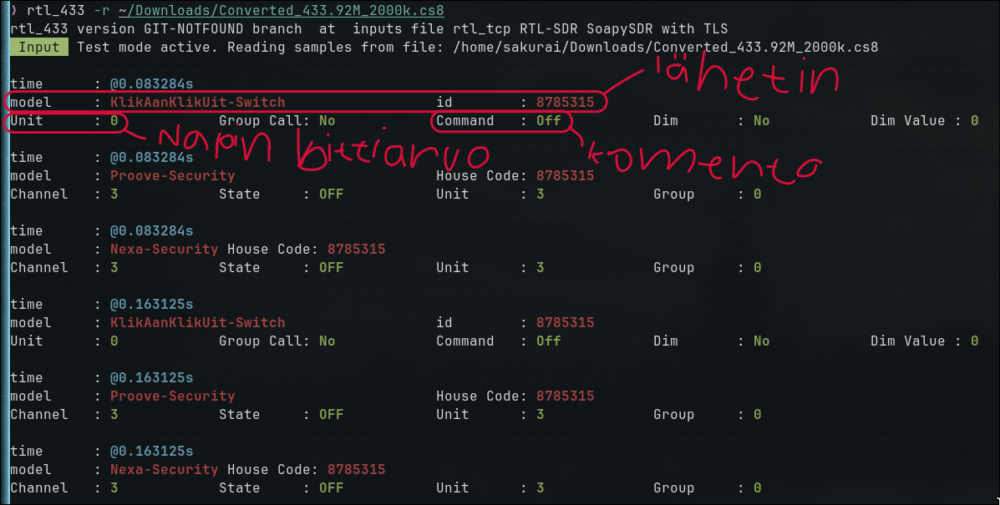

Jokainen löydetty signaali/lähetys on täysin samanlainen, ja se on toistettu tasaisin aikavälein.

---

## d) Too complex 16?

En löytänyt tähän mitään järkevää tietoa pelkästään Googlesta hakemalla, joten kysyin Clauden Opus 5.5 mallilta, miten tämän muunnoksen voisi tehdä, ja vastaus oli seuraavanlainen.

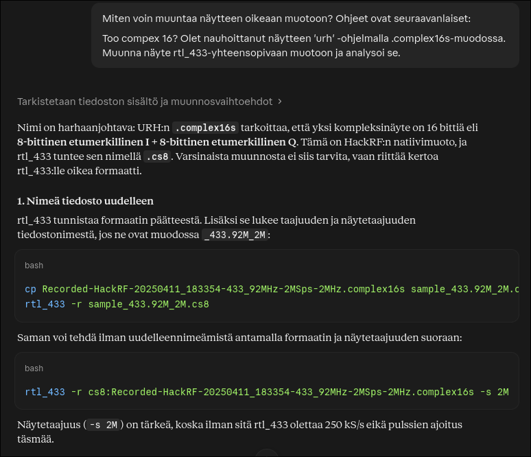

---

Elikkä siis tiedoston muotoa ei käytännössä tarvi muuttaa millään erikoisella tavalla.

Pelkkä tiedoston uudelleen nimeäminen auttaa.

Suoritin komennon `cp Recorded-HackRF-20250411_183354-433_92MHz-2MSps-2MHz.complex16s sample_433.92M_2M.cs8` hakemistossa, johon näytteen latasin.

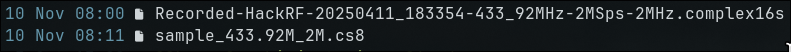

---

Yritin analysoida näytettä `rtl_433`:ssa, mutta tämä kopioiminen uuteen formaattiin ei ollut oikea ratkaisu.

Käytin seuraavaa tekoälyn antamaa vaihtoehtoa, jossa komennossa annetaan suoraan formaatti cs8.

Eli komento olisi nyt seuraavanlainen: `rtl_433 -r cs8:Recorded-HackRF-20250411_183354-433_92MHz-2MSps-2MHz.complex16s`.

Tämä toimi, joten voimme nyt aloittaa analyysin.

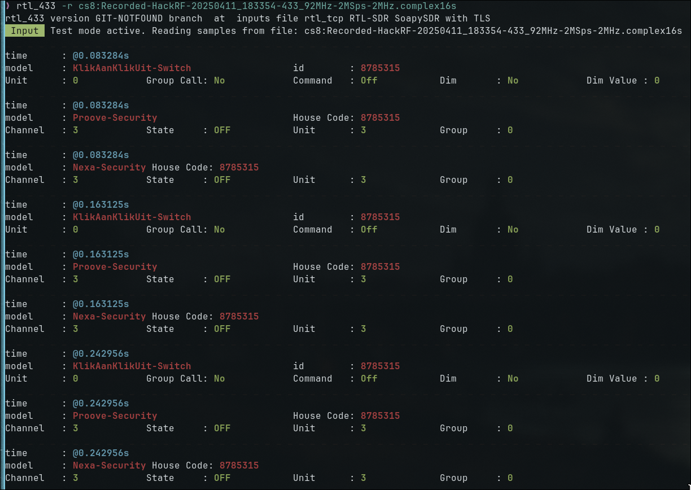

Huomaamme nopeasti, että tämä on täysin sama, tai ainakin samaa tietoa sisältävä näyte, jota tutkimme aikaisemmassa tehtävässä,
joten emme turhaan analysoi sitä uudestaan.

---

## e) Ultimate

Katson jälleen `sudo pacman -Ss urh` -komennolla, että löytyykö Arch repositoriosta Universal Radio Hacker softaa.

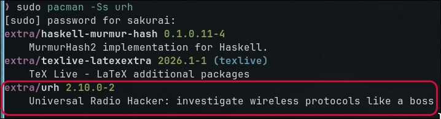

Paketti löytyy joten ladataan se (`sudo pacman -S urh`).

Asennus onnistui ilman ongelmia, joten avataan se.

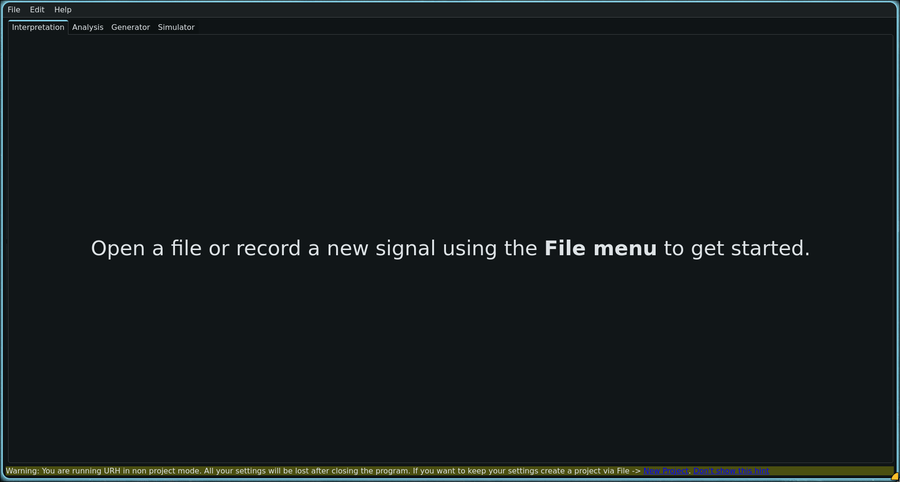

(Haluaisin huomioida, että Tero on matskuissa maininnut urh:n nimeltä 'Ultimate Radio Hacker' moneen otteeseen, vaikka sen oikea nimihän on 'Universal Radio Hacker')

---

URH:ssa avataan Teron antama näyte.

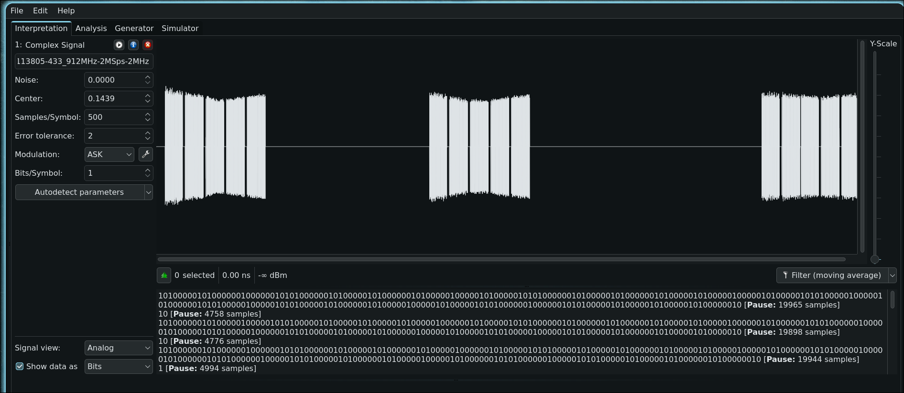

---

## f) Yleiskuva

Näyte on 5.49 sekuntia pitkä, nauhoitusajankohta 11.4.2025 klo 18:33:54, keskitaajuus on 433,92 MHz (megahertz), näytetaajuus 2MS/s (megasamples per second),
kaistaleveys 2 MHz, nämä kaikki näkee suoraan tiedoston nimestä, lukuun ottamatta näytteen pituutta, jonka näin URH:ssa.

**Silmämääräinen kuva.** Analog-tilassa näkyy kolmeen kertaan, viiden signaalin ryhmiä, jokaisen välissä on lyhyt hiljaisuus.

Tausta on täysin tasaista nollaa, joka on epätävallisen puhdasta oikealle radionauhoitukselle.

Kun zoomaa lähemmäs yksittäiseen ryhmään, huomataan että jokaisen ryhmän signaalit ovat identtisiä tai ainakin lähes identtisiä.

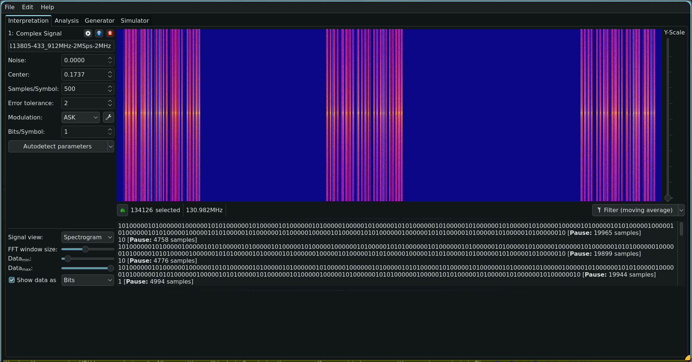

Spectogram -tilassa näemme,e ttä kaikki energia on yhdellä kapealla taajuudella.

---

## g) Bittistä

**Modulaatio.** Koska taajuus pysyy samana ja vain amplitudi vaihtelee (signaali on joko päällä tai
pois), kyseessä on ASK eli tarkemmin OOK (On-Off Keying).

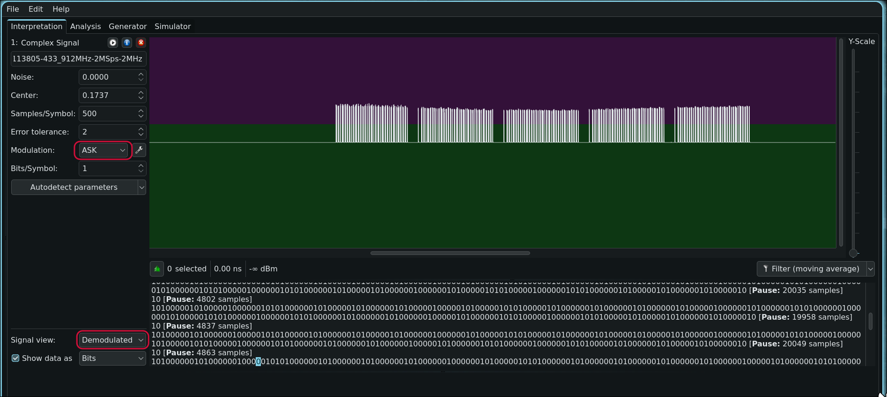

Jos yritämme muuttaa modulaation vertailun vuoksi vaikka FSK, niin modulaatio näyttää sotkuiselta.

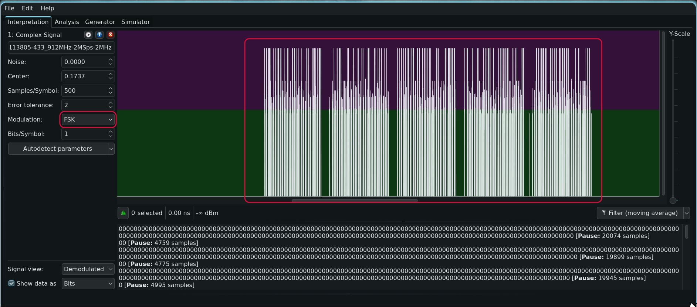

---

**Raakabitin pituus.** Yksi raakabitin pituus on noin 520 näytettä (samples) ja näytetaajuus on 2 MS/s, joten yksi raakabitti kestää 520 / 2 = 260 µs.

Tässä ajassa vertauskohteita voisivat olla:

- Ääni etenee ajassa noin 9 cm
- Silmänräpäys (noin 100-400 ms) on noin tuhat kertaa pidempi.
- Valo ethii kulkea noin 78 km.

(Näiden vertausten laatimiseen kysyin Claude tekoälyltä apua)

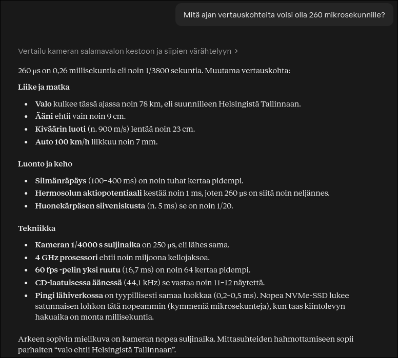

---

## Lähteet

- [Teron Tehtävänanto](https://terokarvinen.com/verkkoon-tunkeutuminen-ja-tiedustelu/#laksyt)
- [Hubacek 2019 YouTube URH SDR Tutorial](https://www.youtube.com/watch?v=sbqMqb6FVMY&t=199s)
- [Decode 433.92 MHz weather station data (Artikkeli)](https://www.onetransistor.eu/2022/01/decode-433mhz-ask-signal.html)
- [Amplitude Shift Keying](https://www.geeksforgeeks.org/electronics-engineering/amplitude-shift-keying/)

Claude Opus -tekoälymalli (Opus 5.5 ja Opus 4.8)
